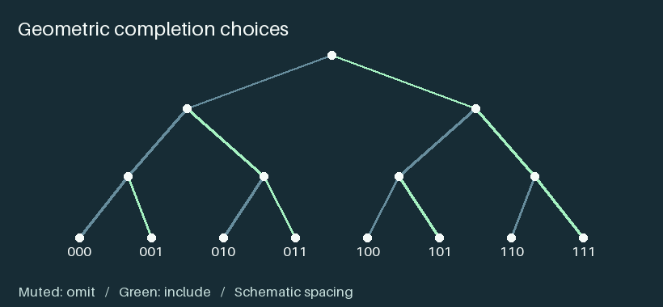

# Local dimension of geometric continued-fraction spectra

   

For each integer q≥2, the dimension spectrum for digits {1,q,q²,…} is nowhere dense above t=log(2)/(2log(q)). At a dimension d in this spectrum the local Hausdorff dimension equals 1 for d≤t and t/d for d>t. For a>t the upper box dimension of the slice at or above a is at most t/a.

[Paper](paper/manuscript.pdf) · [TeX](paper/manuscript.tex) · [Original question, §9](https://doi.org/10.1016/j.indag.2026.03.008) · [Catalog Q1536](https://github.com/10m-u/open-problems-catalog/blob/ca8d4d44ba3db527f19f28928c240168f545ecfe/problems/mathematics/differential-equations-dynamical-systems.md#q1536)

## Explore the proof in 3D

The tree shows nested completion cylinders above the threshold. Branch width shrinks with prefix depth and the independent bits halve mass at each split. Positions and interval lengths are schematic.

[Download the offline explorer](https://raw.githubusercontent.com/DannyExperiments/geometric-spectrum-local-dimension/v1.0.0/visualization/prefix-tree-explorer.zip) · [Explorer source](visualization/index.html) · [Worked example](proof/worked-example.md)

## Proof idea

Uniform dimension truncation turns each finite digit prefix into a short interval and gives the upper box bound. Above t the first differing digit eventually outweighs its whole geometric tail. A quantitative version separates completion cylinders and allows a Bernoulli mass bound, giving the matching local lower estimate.

[Prior-work comparison](audits/public_safe_reports/LITERATURE.md) · [Scope](CLAIM_SCOPE_AND_LIMITATIONS.md) · [Research disclosure](AI_DISCLOSURE.md)

## Replay

    python3 -I scripts/verify_repository.py
    python3 -I verification/src/replay.py

[Recorded checks](verification/results/replay.txt) · [PDF build](paper/BUILD.md) · [Citation metadata](CITATION.cff)

## Cite

DannyExperiments. *Local dimension of geometric continued-fraction spectra*. Version 1.0.0, 27 November 2026. [Version DOI](https://doi.org/10.5281/zenodo.24588797).
